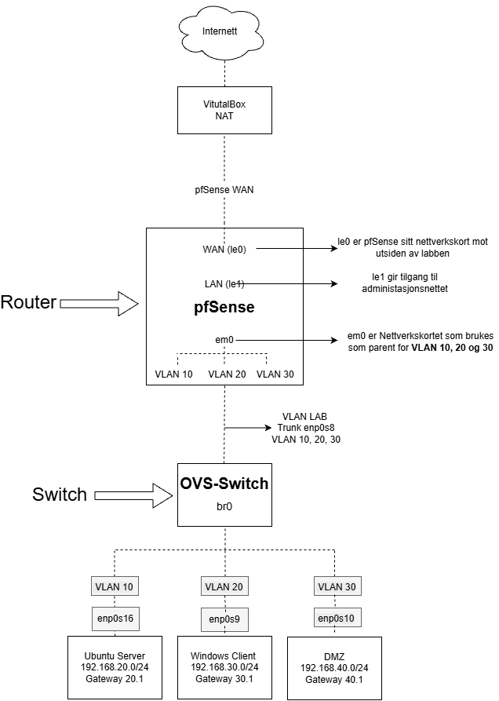

# Nettverk Hjemmelab

Virtuell hjemmelab for praktisk læring innen nettverk, serverdrift og grunnleggende nettverkssikkerhet.  
Labben er bygget med Oracle VirtualBox, pfSense og Open vSwitch. pfSense fungerer som gateway og brannmur, mens Ubuntu Server og Windows brukes som server- og klientmiljø. 

Nettverket er delt inn i flere VLAN for å simulere et mer realistisk nettverksmiljø med separate soner for servere, klienter og DMZ.

## Hva brukes labben til
Prosjektet brukes til å konfigurere, teste og dokumentere ulike nettverksteknologier og sikkerhetsfunksjoner, blant annet:

* VLAN og segmentering
* Routing
* DHCP
* DNS
* Brannmur og tilgangskontroll
* DMZ
* Apache web server
* HTTP / HTTPS

## Arkitektur

  
*Figur 1: Arkitektur av Prosjektet.*

## Komponenter
* Oracle VirtualBox – Virtualisering og virtuelle nettverk  
* pfSense – Gateway, DHCP, DNS, routing og brannmur  
* Open vSwitch – Virtuell VLAN-switch  
* Ubuntu Server (VLAN 10) – Intern server i servernettverket
* Ubuntu Server (DMZ / VLAN 30) – DMZ-server med Apache Web Server
* Windows (VLAN 20) – Klientmiljø og testing
* VLAN / 802.1Q - Nettverkssegmentering og VLAN-tagging

## IP Plan

| Enhet | IP-adresse | Nettverk | Rolle |
|---|---|---|---|
| pfSense | `192.168.10.1` | LAN | Gateway |
| OVS | `192.168.10.101` | LAN | Administrasjon |
| pfSense | `192.168.20.1` | SERVERS | Gateway |
| Ubuntu Server | `192.168.20.100` | SERVERS | Server |
| pfSense | `192.168.30.1` | CLIENTS | Gateway |
| Windows Client | `192.168.30.100` | CLIENTS | Klient |
| pfSense | `192.168.40.1` | DMZ | Gateway |
| Ubuntu DMZ | `192.168.40.10` | DMZ | DMZ-server |

## OVS-oppsett

Open vSwitch brukes som den virtuelle VLAN-switchen i labben. OVS kobler pfSense sammen med server-, klient- og DMZ-nettverkene.

| Interface | Nettverk | Type | VLAN |
|---|---|---|---:|
| `enp0s8` | VLAN-LAB | Trunk | 10, 20, 30 |
| `enp0s9` | CLIENTS-ACCESS | Access | 20 |
| `enp0s10` | DMZ-ACCESS | Access | 30 |
| `enp0s16` | SERVER-ACCESS | Access | 10 |

## pfSense-oppsett

pfSense fungerer som gateway, DHCP-server, DNS, routing og brannmur i labben.

| Nettverk | Interface | IP-adresse |
|---|---|---|
| LAN | LAN | `192.168.10.1/24` |
| SERVERS | VLAN 10 | `192.168.20.1/24` |
| CLIENTS | VLAN 20 | `192.168.30.1/24` |
| DMZ | VLAN 30 | `192.168.40.1/24` |

VLAN 10, 20 og 30 er opprettet på `em0`, som er parent-interface for VLAN-nettverkene.

## VLAN-plan

VLAN brukes for å dele nettverket opp i separate logiske nettverk.

| VLAN | Navn | Subnett | Gateway | Bruk |
|---:|---|---|---|---|
| 10 | SERVERS | `192.168.20.0/24` | `192.168.20.1` | Servere |
| 20 | CLIENTS | `192.168.30.0/24` | `192.168.30.1` | Klienter |
| 30 | DMZ | `192.168.40.0/24` | `192.168.40.1` | DMZ |

VLAN brukes for å dele nettverket opp mellom servere, klienter og DMZ.  
- VLAN 10 – SERVERS  
- VLAN 20 – CLIENTS  
- VLAN 30 – DMZ  

**Oppdatert VLAN Konfigurasjon, oppdatert den 10/30/2026**      
Open vSwitch bruker en trunkforbindelse mot pfSense som transporterer VLAN 10, 20 og 30.

VLAN 20 og VLAN 30 har egne access-porter på Open vSwitch. Opprinnelig manglet VLAN 10 en egen access-port fordi alle fire virtuelle nettverkskortene på OVS-VM-en allerede var i bruk. Ubuntu Server brukte derfor et eget VLAN-interface konfigurert med Netplan for å håndtere VLAN 10.

For å løse dette opprettet jeg et ekstra virtuelt nettverkskort på OVS-VM-en ved hjelp av VBoxManage via CLI. Det nye grensesnittet, enp0s16, ble lagt til som en access-port på VLAN 10. Deretter endret jeg nettverkskonfigurasjonen på Ubuntu Server til å bruke DHCP uten manuell VLAN-tagging i Netplan, og fjernet det gamle VLAN 10-grensesnittet.

## Tjenester
* DHCP
* DNS
* IPv4 routing
* NAT
* Firewall
* Apache Web Server

## Brannmur regler

### Begrensning av tilgang til pfSense sitt webgrensesnitt

* Tilgangen til pfSense sitt webgrensesnitt er konfigurert slik at administrasjon skjer via LAN-adressen 192.168.10.1/24.

* Administrasjonen utføres fra Windows-klienten på CLIENTS-nettverket (192.168.30.0/24), med IP-adressen 192.168.30.100.

* Tilgangen via gateway-adressene til SERVERS (192.168.20.1), CLIENTS (192.168.30.1) og DMZ (192.168.40.1) er ikke tilgjengelig lenger. Jeg har begrenset dette slik at det er kun mulig og nå pfSense sitt webgrensesnitt via 192.168.10.1.

## Feilsøking

**Eksempler fra prosjektet:**

* DHCP-problemer  
* VLAN-tagging  
* Trunk- og access-porter  
* Virtuelle nettverkskort  
* Routing  
* Brannmurregler  
* Nettverksinterface som ikke var aktive
* VirtualBox nettverksinnstillinger
* Promiscuous Mode

Detaljert feilsøking og løsninger dokumenteres i `docs/journal/feilsøking/` sammen med relevante kommandoer og resultater.

## Status

Labben fungerer og satt opp slik den er vist i Nettverksarkitekturen. 

## Ferdig
* VirtualBox-nettverk
* pfSense gateway og brannmur
* LAN
* VLAN 10 / SERVERS
* VLAN 20 / CLIENTS
* VLAN 30 / DMZ
* Open vSwitch
* VLAN trunk
* Access-port for klienter
* Access-port for DMZ
* Access-port for Servers
* DHCP
* Ubuntu DMZ
* Apache Web Server
* Nettverkstesting og feilsøking

## Teknologier

* VirtualBox  
* pfSense  
* Open vSwitch  
* Ubuntu Server
* Ubuntu DMZ  
* Windows   
* VLAN/802.1Q  
* IPv4  
* DHCP  
* DNS   
* NAT  
* Routing  
* Firewall  
* Apache  
* Netplan  
